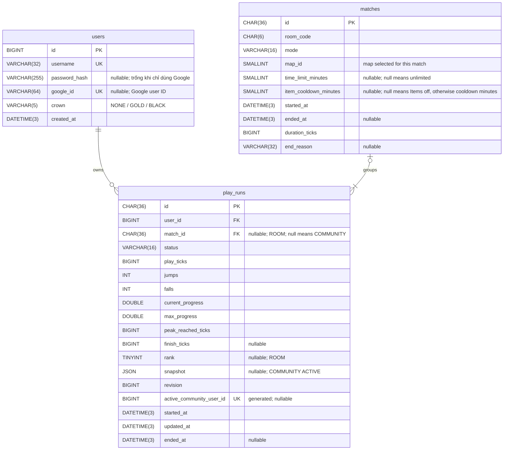

# Thiết kế dữ liệu

MySQL/InnoDB, utf8mb4, timestamps UTC. Hibernate chỉ validate; `source/database/schema.sql` tạo database mới. Với database hiện có theo schema trước đó, dừng backend, sao lưu rồi chạy `source/database/migrate-to-current-schema.sql` một lần trong MySQL Workbench. Script kiểm tra schema và dữ liệu nickname trước khi đổi; DDL MySQL tự commit từng bước. Database lưu Account, lượt Community và kết quả Room; gameplay đang chạy của Room ở RAM.

## Schema

| Bảng | Trách nhiệm |
| --- | --- |
| users | Account, password hash, google_id và quyền vương miện |
| play_runs | Một lượt của một Account: metrics, kết quả và checkpoint Community |
| matches | Thông tin chung của trận Room, liên kết các lượt tham gia |

Community không có match; Room có nhiều runs cùng match. users.id tự tăng, run/match ID là UUID do server tạo. UUID/room code dùng ascii_bin, username dùng utf8mb4_0900_ai_ci; FK dùng RESTRICT.

| Trường | Ý nghĩa |
| --- | --- |
| play_ticks / duration_ticks | Thời gian active của lượt / clock chung trận Room |
| jumps / falls | Số lần launch / splat |
| current_progress / max_progress | Tiến độ xếp hạng / peak theo [gameplay](gameplay.md#room-và-xếp-hạng) |
| peak_reached_ticks | play_ticks lần đầu đạt peak; chỉ đổi khi peak tăng |
| finish_ticks | Clock Community hoặc clock trận Room khi Finish |
| rank | Hạng cuối Room |
| snapshot / revision | Checkpoint / thứ tự payload ghi từ 1 do writer quản lý, không phải Hibernate @Version |
| started_at / updated_at / ended_at | Bắt đầu / commit gần nhất / kết thúc; không dùng hiệu timestamp tính thành tích |

Ticks đổi sang ms bằng floor(ticks×1000/tickRate), theo [nhịp mô phỏng](architecture.md#xử-lý-đồng-thời). Counters/ticks không âm, peak≥current≥0, peak_reached_ticks≤play_ticks; số qua JSON không vượt Number.MAX_SAFE_INTEGER. Community Finish có finish_ticks=play_ticks; Room có play_ticks/finish_ticks≤duration_ticks.

## Trạng thái và ràng buộc

| Status | Phạm vi |
| --- | --- |
| ACTIVE | Đang dở; Community paused/offline vẫn ACTIVE |
| FINISHED | Đã Finish |
| ABANDONED | Community được thay bằng New Game |
| UNFINISHED | Chưa Finish khi Room kết thúc, vẫn tham gia |
| DNF | Đã rời/hết reconnect Room hoặc trận bị abort |

- `match_id IS NULL` xác định lượt Community; có `match_id` xác định lượt Room. Rank chỉ áp dụng cho Room; server chốt rank cho toàn bộ roster với mọi `end_reason`. Snapshot chỉ dùng cho lượt Community đang ACTIVE. API có thể trả `kind` như trường phân loại suy ra từ `match_id`, nhưng không lưu trùng trong `play_runs`.
- Backend quản lý vòng đời và tập giá trị hợp lệ của `status`, `end_reason`, `mode`, `crown` cùng các giới hạn nghiệp vụ. Database lưu chúng bằng cột chuỗi, không dùng ENUM hoặc CHECK liệt kê giá trị hợp lệ. Database chỉ giữ các ràng buộc cấu trúc như khóa, kiểu dữ liệu, bộ đếm không âm, quan hệ thời gian và JSON hợp lệ.
- `map_id` là ID map độc lập, không biểu thị level/độ khó; backend chọn map mặc định 1. `time_limit_minutes` NULL nghĩa là không giới hạn; nếu có giá trị thì backend kiểm tra 1–10 phút. `item_cooldown_minutes` NULL nghĩa là tắt Items; chọn 1–5 phút sẽ bật Items với cooldown đó. Room mới mặc định không giới hạn thời gian và tắt Items. Database không đặt default hoặc giới hạn nghiệp vụ cho các trường này.
- Indexes: unique username và google_id, unique (match_id,user_id), (user_id,ended_at,id), (match_id,status). `active_community_user_id` là cột generated phục vụ unique index, nhận user_id khi lượt Community đang ACTIVE; unique bảo đảm tối đa một checkpoint đang dở/Account. Đây là ràng buộc duy nhất dựa vào trạng thái trong database để bảo vệ tính duy nhất khi ghi đồng thời. Startup kiểm tra đúng bảng/cột của unique indexes, không tự sửa schema.

## Transaction và ghi dữ liệu

Owner lấy từ session, không nhận user_id/metrics chính thức từ client. Entity chỉ ở persistence layer; API đọc projection, không tải snapshot để tính bảng dữ liệu. Không giữ transaction hoặc chờ DB trong vòng tick.

Writer nhận payload bất biến, xử lý theo thứ tự lượt/trận; có thể gộp autosave nhưng không bỏ mốc Pause/Leave/Finish. Ghi dữ liệu phải bảo đảm:

- Chỉ nhận revision mới hơn; cùng revision/nội dung là no-op, khác nội dung là CONFLICT. Counters/peak không giảm; lượt terminal giữ metrics, Room rank chốt khi finalize. Autosave không phục hồi lượt kết thúc hoặc upsert lượt đã mất.
- Mọi thao tác cạnh tranh cùng Account/run/match được tuần tự hóa trong transaction; dùng thứ tự khóa thống nhất, không ghi đè payload mới bằng payload cũ.
- Retry cùng ID/kết quả không tạo hàng hoặc cộng tổng lần nữa. PENDING/SAVED/FAILED phản ánh đúng trạng thái; SAVED chỉ sau commit, retry có giới hạn và cấu hình tập trung phía backend.
- users.crown nhận NONE/GOLD/BLACK (không đeo/vàng/kim cương), chỉ nâng cấp khi Finish full map theo [gameplay](gameplay.md#nội-dung-và-nhận-diện), cùng transaction với kết quả. Server lấy tiến độ quạ của chính người Finish trong lượt đó; không nhận quyền crown từ client. Password/session theo [protocol](protocol.md#xác-thực-và-bảo-mật).

## Checkpoint Community

Save thuộc run/Account, không thuộc room code. Continue yêu cầu đúng owner, COMMUNITY/ACTIVE và expectedRunId; sai trả CONFLICT, không tự tạo lượt. New Game kiểm tra expectedRunId, chốt lượt cũ ABANDONED/xóa snapshot và tạo lượt mới revision=1 trong một transaction; rollback giữ save cũ.

Checkpoint gồm physics/adventure/world đủ Continue: position/velocity/buffers, Fly/phasing fall, hội thoại theo ID, tiến độ quạ, screen events/hidden walls/gió và mốc tên vùng. Codec version kiểm tra cấu trúc; không lưu shared definitions hoặc nội dung hiển thị. Metrics/snapshot/revision nhất quán trong một lần ghi; restore lỗi không tự thay save bằng spawn.

Autosave chỉ cập nhật đúng run đang ACTIVE. Finish chốt status/finish_ticks/ended_at và xóa snapshot atomically. Điều kiện ổn định trước Pause/Leave, Resume và Fly theo [gameplay](gameplay.md).

## Room và kết quả

Sau countdown, tạo match và runs ROOM của roster trong một transaction; countdown bị hủy không ghi trận. Mỗi Start dùng ID mới. Mode/map/Item settings bất biến trong match; Lobby, visibility, reconnect token, item/cooldown/bẫy và physics chỉ ở RAM.

Ghi định kỳ clock/metrics, flush tại End/Finish/Leave. Người DNF giữ metrics/ended_at đã chốt. Finalize atomically ghi reason/duration/ended_at của match và status/rank toàn roster. Mọi `end_reason` đều có bảng xếp hạng; reason chỉ giải thích vì sao trận kết thúc. Retry không thay kết quả. Mode Easy lưu dưới giá trị EASY; điểm an toàn chỉ thuộc state trận trong RAM, không thêm bảng hoặc ghi database mỗi lần thay điểm.

Phòng hết người giữ payload chưa commit để retry trong quota. Shutdown flush có giới hạn; restart chốt match mở ABORTED và runs ROOM ACTIVE thành DNF bằng metrics đã commit. Không cộng thời gian offline hoặc khôi phục physics Room.

## History, Stats và leaderboard

| Dữ liệu | Nguồn |
| --- | --- |
| History | Community terminal theo run ID; Room đã finalize theo match ID; mới nhất trước theo ended_at rồi ID |
| Chi tiết Room | Account từng tham gia xem roster/kết quả; username lấy từ `users` |
| Stats tổng | SUM counters/ticks đã commit; số Finish, số trận Room, số Room Wins; MIN finish_ticks của lượt full map |
| Leaderboard | Chỉ Community, một best run/Account; comparator theo [gameplay](gameplay.md#community) |

ACTIVE/match chưa finalize không vào History; metrics đã commit vẫn góp Stats/leaderboard. Chỉ Community có status FINISHED mới góp Finishes; Room không góp Finishes dù người chơi hoàn thành map Room. Room Wins được tính riêng; Room ngắn không góp Best Finish Time/crown. Không lưu thêm tổng cộng dồn trong users; giữ các hàng metrics làm nguồn tổng và lịch sử.

Room Wins đếm lượt Room hạng 1 trong trận đã finalize, kể cả đồng hạng; chỉ nhận FINISHED/UNFINISHED và loại trận ABORTED. Tính trực tiếp từ rank/status/match, không lưu thêm cờ winner hoặc bộ đếm trong database.

Query dùng tham số/projection, kiểm tra owner, không lộ snapshot. Leaderboard chọn best run mỗi Account, tính RANK trước LIMIT; ID chỉ ổn định hiển thị, không phá đồng hạng.
