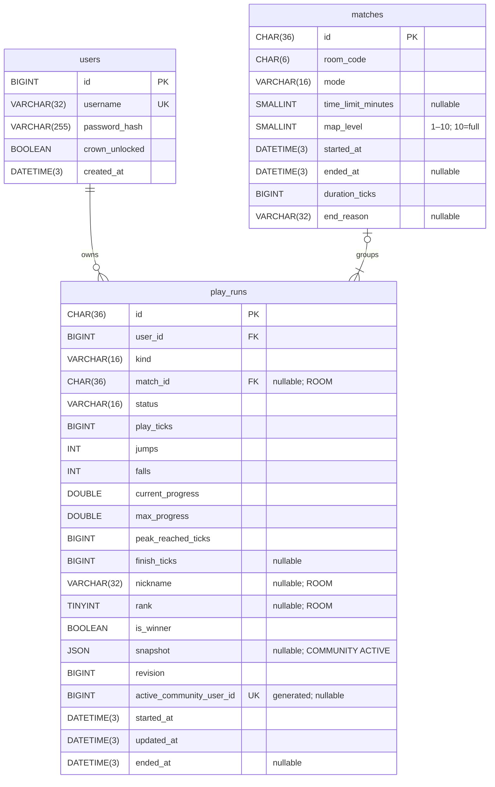

# data.md

## Schema

Database `jumpking`, MySQL/InnoDB, utf8mb4, timestamps UTC. Schema tạo bằng `source/database/schema.sql`; Hibernate chỉ validate mapping khi start; SQL giữ constraints và indexes. Khởi tạo/reset theo [deployment](deployment.md#mysql).

| Bảng | Trách nhiệm |
| --- | --- |
| users | Account, password hash và vương miện |
| play_runs | Một lượt của một người: metrics, kết quả Room và checkpoint Community |
| matches | Thông tin chung của một trận Room |

Community có lượt cá nhân; Room có match chung. Phạm vi save/thành tích theo [gameplay](gameplay.md#phạm-vi-và-kiểu-chơi).



users.id tự tăng; lượt/match dùng UUID server. UUID/hash/room code dùng ascii_bin, username dùng utf8mb4_0900_ai_ci. FK dùng RESTRICT để giữ dữ liệu thống kê.

| Trường trong play_runs | Ý nghĩa |
| --- | --- |
| kind / match_id | COMMUNITY hoặc ROOM; chỉ ROOM có match_id |
| play_ticks / jumps / falls | Thời gian tham gia và số lần launch/splat của một lượt |
| current_progress / max_progress | Tiến độ hiện tại/lúc dừng và peak; định nghĩa theo [gameplay](gameplay.md#room-và-xếp-hạng) |
| peak_reached_ticks | play_ticks tại lần đầu đạt max_progress; chỉ thay khi peak tăng, không thay khi leo lại đúng peak cũ |
| finish_ticks | Thời gian đến đích; Community dùng clock lượt, Room dùng clock trận |
| nickname / rank / is_winner | Tên lúc tham gia, thứ hạng cuối và winner Room; không suy winner chỉ từ rank=1 |
| snapshot | State đầy đủ để Continue Community |
| revision | Số thứ tự bản ghi từ 1 |
| active_community_user_id | Cột DB tự tính để giới hạn một lượt Community ACTIVE/Account |
| started_at / updated_at / ended_at | Bắt đầu, lưu thành công gần nhất và kết thúc; không dùng hiệu thời gian lịch để xếp hạng |

Ticks theo [architecture](architecture.md#xử-lý-đồng-thời); API đổi thành ms bằng floor(ticks×1000/tickRate). Counters/ticks không âm, max_progress≥current_progress≥0, 0≤peak_reached_ticks≤play_ticks. finish_ticks bằng play_ticks với Community, không vượt duration_ticks với Room.

| status | Ý nghĩa và phạm vi |
| --- | --- |
| ACTIVE | Lượt chưa kết thúc; Community paused/offline vẫn ACTIVE |
| FINISHED | Đã đến đích; finish_ticks khác NULL |
| UNFINISHED | Room kết thúc khi người này còn tham gia nhưng chưa Finish |
| ABANDONED | Bỏ lượt Community để bắt đầu lượt mới |
| DNF | Rời Room/hết hạn reconnect trước khi trận kết thúc, hoặc trận bị abort |

Chỉ ACTIVE có ended_at=NULL; trạng thái khác có ended_at≥started_at. Chỉ FINISHED có finish_ticks khác NULL. Community không dùng UNFINISHED/DNF; Room không dùng ABANDONED. snapshot là JSON object chỉ khi kind=COMMUNITY và status=ACTIVE; còn lại NULL. match_id/nickname chỉ có ở ROOM; rank NULL đến khi finalize, sau đó trong [1,10]. Ngoài ROOM, rank=NULL và is_winner=false. Winner chỉ khi FINISHED, rank=1.

Indexes: unique username/active_community_user_id; play_runs(user_id,ended_at,id), unique play_runs(match_id,user_id), play_runs(kind,status) cho Profile/History/detail/leaderboard. Mỗi Account có một lượt trong một trận Room.

```sql
active_community_user_id BIGINT GENERATED ALWAYS AS
    (CASE WHEN kind = 'COMMUNITY' AND status = 'ACTIVE'
          THEN user_id ELSE NULL END) VIRTUAL,
UNIQUE KEY uq_active_community_user (active_community_user_id)
```

Cột generated tự tính, chỉ lượt Community ACTIVE có user_id; các lượt khác NULL. CHECK bảo vệ tổ hợp kind/status/NULL và biên cùng hàng, dùng IS NULL/IS NOT NULL tường minh. Service kiểm tra owner Account, roster/rank/comparator và biên thời gian giữa hai bảng trong transaction. [MySQL generated columns](https://dev.mysql.com/doc/refman/8.4/en/create-table-generated-columns.html), [unique indexes](https://dev.mysql.com/doc/refman/8.4/en/create-index.html), [CHECK constraints](https://dev.mysql.com/doc/refman/8.4/en/create-table-check-constraints.html).

## Identity và ownership

Account đăng ký bằng username/password; server lưu password hash; users chỉ chứa Account. Mọi thao tác online lấy owner từ session. Tên player lấy từ username, kết quả Room giữ snapshot tên lúc Join. Thay đổi mật khẩu cần mật khẩu hiện tại và thu hồi các phiên sau commit theo [protocol](protocol.md#identity-và-security).

## Ghi lượt

New Game/Room Start tạo UUID mới; Continue/reconnect giữ ID. Ghi counters tích lũy trong transaction: revision mới hơn được cập nhật, bản cũ bỏ qua, cùng revision/nội dung là no-op, cùng revision khác nội dung là CONFLICT. Counters/peak không giảm; metrics đã kết thúc bất biến, rank/winner Room chốt ở finalize.

## Community checkpoint

Continue chỉ khôi phục COMMUNITY/ACTIVE thuộc Account và khớp expectedRunId; không có/khác ID thì CONFLICT, không tạo lượt. New Game mới tạo spawn snapshot, revision=1. Save thuộc lượt, không gắn room code. Save & Exit/Continue/AFK giữ lượt, không gắn lượt với một sảnh cố định.

Snapshot do server tạo: physics (freeFlight/phasingFall), hội thoại theo ID, tiến độ/vị trí/vận tốc quạ, screen events/hidden walls/pha gió và codec version. Tiến độ quạ chưa được ghi nhận bắt đầu tại điểm đậu đầu tiên. Không chứa định nghĩa shared hoặc nội dung hiển thị. Backend validate codec/metrics khi restore; xử lý quyền bay theo [gameplay](gameplay.md#fly-mode).

Autosave ghi metrics/snapshot/revision/updated_at cùng transaction trên đúng id/owner/COMMUNITY/ACTIVE, không upsert lượt đã mất. Worker tuần tự từng lượt, gộp bản chưa ghi. Chu kỳ theo [deployment](deployment.md#cấu-hình); Pause/Leave/Finish yêu cầu flush.

New Run khóa users rồi lượt bằng SELECT ... FOR UPDATE, kiểm tra expectedRunId; chốt lượt ACTIVE cũ ABANDONED/ended_at, tăng revision/updated_at, xóa snapshot và insert lượt mới trong một transaction. Rollback giữ save cũ. Finish chốt metrics/FINISHED/finish_ticks/ended_at, tăng revision/updated_at và xóa snapshot atomically. Writer cũ không phục hồi lượt. [MySQL locking reads](https://dev.mysql.com/doc/refman/8.4/en/innodb-locking-reads.html).

## Kết quả Room

Room bắt đầu gameplay tạo match và lượt ROOM của roster trong một transaction bằng IDs chốt khi Start; Lobby/countdown hủy không ghi. started_at là hết countdown. Mode/settings/map_level nằm ở matches theo [gameplay](gameplay.md#room-và-xếp-hạng); time_limit_minutes chỉ khác NULL ở TIME_LIMIT. end_reason: FINISH/TIME_LIMIT/HOST_ENDED/ALL_DISCONNECTED/ABORTED.

Writer lưu duration_ticks/metrics định kỳ theo deployment và flush khi kết thúc; không lưu snapshot Room. Leave/hết hạn reconnect chốt DNF; finalize chốt người còn lại UNFINISHED/FINISHED. play_ticks≤duration_ticks; xếp hạng dùng clock chung theo gameplay.

Finalize ghi match và metrics/rank/winner trong một transaction, tăng revision/updated_at; giữ metrics/ended_at đã chốt của DNF. Match đang chơi có ended_at/end_reason cùng NULL, kết thúc cùng khác NULL và ended_at≥started_at. Service kiểm tra roster 1–10, đúng match/kind, rank≤số người và comparator. Retry giữ UUID: cùng kết quả no-op, khác kết quả đã chốt báo lỗi.

Room hết thành viên vẫn giữ kết quả chưa ghi trong quota phòng; retry cùng payload, chỉ giải phóng sau commit. Shutdown flush có giới hạn thời gian; không báo SAVED khi ghi lỗi.

Restart chốt match còn mở ABORTED, lượt ROOM ACTIVE thành DNF. Dùng metrics đã commit để xếp hạng, không cộng ticks offline hoặc tạo winner mới. Giới hạn phục hồi theo [architecture](architecture.md#lỗi-và-khả-năng-mở-rộng).

## History và leaderboard

| Dữ liệu | Nguồn |
| --- | --- |
| History Community | play_runs đã kết thúc; mỗi lượt một mục của owner |
| History Room | matches và play_runs ROOM; mỗi match đã finalize một mục của owner |
| Profile Stats | SUM(play_ticks/jumps/falls), số lượt FINISHED và MIN(finish_ticks) full map từ play_runs của identity |
| Số trận/thắng Room | COUNT lượt ROOM, riêng thắng lọc is_winner=true |
| Leaderboard | Chỉ play_runs COMMUNITY; một best run mỗi Account theo [gameplay](gameplay.md#community-tower) |

Account History gộp Community theo run ID và Room theo match ID, mới nhất trước theo ended_at rồi kind/id. Chỉ owner đọc được lượt cá nhân; Account tham gia được đọc chi tiết trận. Summary Room lấy lượt của Account, detail hiển thị roster của trận. Contract theo [protocol](protocol.md#http).

Lượt Community ACTIVE và Room chưa finalize chưa vào History. Thống kê Account lấy tổng đã commit của Community/Room; không tổng hợp hoặc đồng bộ dữ liệu local, không có bộ lọc kind/mode.

Leaderboard lấy metrics Community đã commit; chọn best bằng ROW_NUMBER rồi tính RANK trước LIMIT. ID chỉ ổn định lựa chọn/hiển thị, không phá đồng hạng. Comparator/eligibility theo [gameplay](gameplay.md#community-tower). [MySQL window functions](https://dev.mysql.com/doc/refman/8.4/en/window-function-descriptions.html).

Giữ hàng metrics để bảo toàn tổng/History/best. Query có tham số và kiểm tra ownership, chỉ chọn cột cần dùng; Stats/History/leaderboard không đọc snapshot hoặc credentials/token.

Persistence online dùng PENDING/SAVED/FAILED; SAVED chỉ sau commit. Quản trị MySQL theo [deployment](deployment.md#mysql).

## JPA

User, PlayRun và Match ánh xạ ba bảng; Service sở hữu transaction, Repository sở hữu truy vấn. Không serialize Entity. Chỉ đọc snapshot khi Continue/save, dùng projection cho Stats/History/leaderboard. `revision` giữ thứ tự payload và chống retry khác nội dung, không thay bằng optimistic version của ORM. New Run và writer khóa owner theo thứ tự rồi khóa lượt trong transaction.

`users.crown_unlocked` chỉ chuyển false → true khi Account hoàn thành full map.

`matches.map_level` trong [1,10], mặc định 10 (full map); Public/Private là metadata phòng RAM, không cần lưu khi match kết thúc. Best Finish Time bỏ Room map_level<10; counters/Finishes/Room Wins vẫn tính.

Hibernate `validate` không thay thế kiểm thử CHECK/unique/FK trong MySQL thật.
