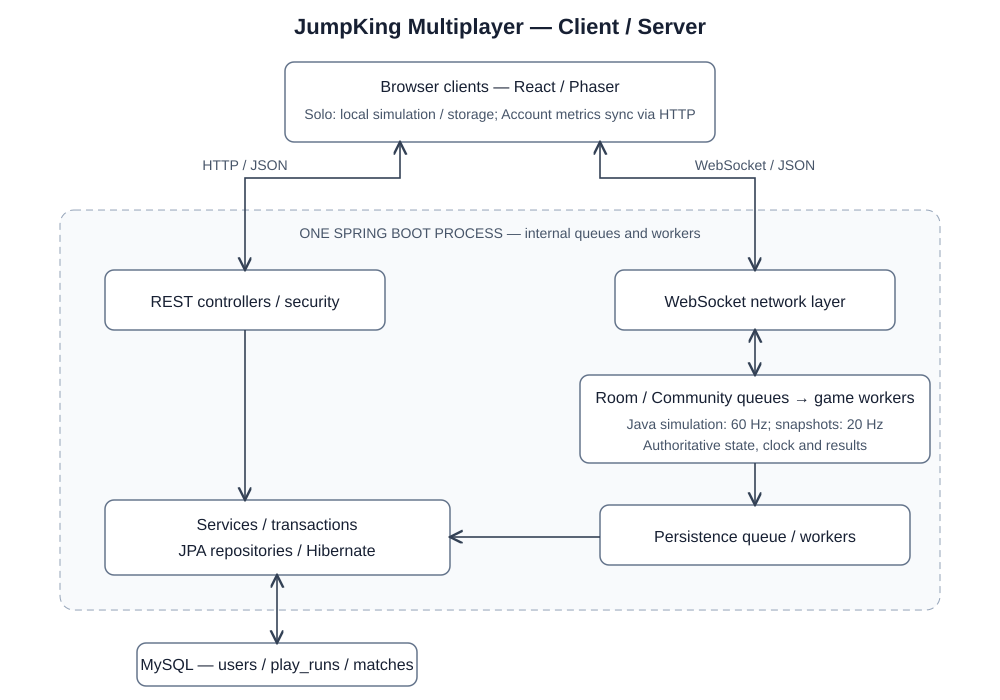
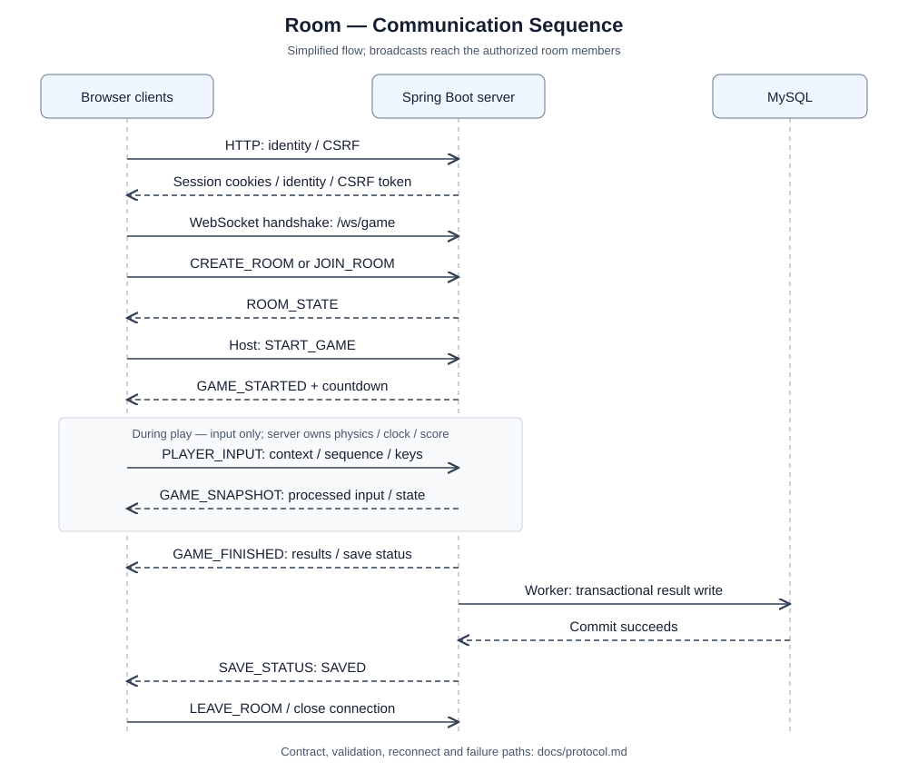

# JumpKing Multiplayer

**Đồng bộ trạng thái và lưu tiến độ nhất quán trong game Client-Server**

## Tóm tắt

Game nhảy chính xác cần phản hồi điều khiển nhanh nhưng kết quả online phải do server xác nhận. JumpKing Multiplayer giải quyết hai yêu cầu này bằng Spring Boot/Java mô phỏng authoritative ở 60 Hz, client TypeScript prediction/reconciliation và snapshot WebSocket 20 Hz. Dữ liệu map, tuning và fixtures dùng chung; hai implementation được kiểm chứng độc lập với phần hiển thị Phaser. JPA/MySQL lưu tiến độ và kết quả ngoài vòng tick, có revision, khóa và retry để tránh ghi đè hoặc cộng trùng. Hệ thống gồm Community Tower và Room tối đa 10 người. Trong đợt đo ngày 15/10/2026, hồi quy đạt 77 client unit, 54 Java unit, 77 MySQL integration và 62 Chrome scenarios qua các harness. Thực nghiệm tải riêng giữ khoảng 20 snapshots/giây/client ở Room 10 người; RTT p95 trên loopback là 2,31 ms. Với trễ mô hình 100 ms mỗi chiều, prediction giảm thời gian nhìn thấy cú nhảy từ 566,7 xuống 350 ms, cùng thời gian charge. Các kết quả chứng minh tính khả thi trong môi trường đo, chưa xác định sức chứa VPS hoặc chất lượng mạng Internet.

**Từ khóa:** server-authoritative; WebSocket; client-side prediction; concurrency; checkpoint; transaction.

## 1. Giới thiệu

Jump King là game leo bằng những cú nhảy tích lực, trong đó sai hướng hoặc va chạm có thể làm mất nhiều độ cao [1]. Khi đưa trải nghiệm này lên web nhiều người, client cần phản hồi ngay trong khi server phải chống nhận vị trí, thời gian hoặc kết quả do người chơi tự khai báo. Mạng chậm, reconnect và database lỗi còn có thể gây nhảy ngoài ý muốn, mất checkpoint hoặc ghi kết quả nhiều lần.

Mục tiêu của dự án là xây dựng một hệ thống mạng có trạng thái, phục vụ nhiều identities, tách simulation khỏi transport/database và đo được tác động của cơ chế đồng bộ. Phạm vi gồm Main Babe 43 screen, Community lưu tiến độ, Room cùng xuất phát, chat, History và leaderboard Community. Đây là đóng góp tích hợp và kiểm chứng hệ thống; không đề xuất một thuật toán prediction mới.

## 2. Cơ sở và phương pháp liên quan

WebSocket thiết lập handshake rồi trao đổi messages hai chiều trên một kết nối TCP [2]. Giao thức vận chuyển không tự quy định luật game, quyền điều khiển hay reconnect; ứng dụng phải bổ sung các contract này. HTTP phục vụ các thao tác Account và Records, còn WebSocket phục vụ dòng input/snapshot liên tục.

Prediction cho client áp dụng input ngay; reconciliation khôi phục trạng thái authoritative rồi phát lại input chưa được xác nhận. Cách đánh số input và replay này là một phương pháp đã được mô tả trong tài liệu của Gambetta [3]. Baseline thực nghiệm ở đây chỉ hiển thị snapshot nhận được, không prediction và không interpolation cho nhân vật bản thân. Cả hai biến thể dùng cùng map, input và simulation để tách riêng tác động của prediction.

---

## 3. Bài toán và ràng buộc

| Thành phần | Định nghĩa trong dự án |
| --- | --- |
| Input online | Các trạng thái điều khiển, playId, generation và sequence; không nhận vị trí hoặc điểm |
| Output | Snapshot authoritative, kết quả Room, checkpoint Community và Records đã commit |
| Mô hình mạng | Browser giao tiếp HTTP/WebSocket với một backend; MySQL chỉ backend truy cập |
| Tính đúng | Không vượt quyền Host/owner, không đổi map giữa trận, không nhân đôi kết quả khi retry |
| Phạm vi vận hành | Một backend instance; Room trong RAM, Community có checkpoint bền vững |

Community yêu cầu Account, lưu checkpoint theo Account và tính leaderboard từ dữ liệu server. Room yêu cầu Account; Host chọn Public/Private, mode và độ dài map trước khi Start từ một người.

## 4. Kiến trúc hệ thống



React quản lý các màn hình; Phaser chỉ hiển thị và phát presentation. Java/TypeScript viết simulation riêng, dùng JSON chung thay vì chia sẻ mã thực thi. Backend tổ chức controller/service/repository/entity/dto; game và room không giữ managed Entity. Service sở hữu transaction; Repository truy cập MySQL. JPA tắt Open EntityManager in View và chỉ validate schema khi khởi động.

---

## 5. Thiết kế giao tiếp mạng



Client lấy CSRF trước mutation HTTP, đăng nhập bằng session cookie rồi mở `/ws/game`. Handshake kiểm tra identity và Origin. Mỗi command có requestId để ghép response; input dùng playId/generation/seq. Ví dụ message version 1:

```json
{"v":1,"type":"PLAYER_INPUT","payload":{
  "playId":"00000000-0000-4000-8000-000000000001",
  "generation":1,"seq":1,"left":false,"right":true,"jump":true}}
```

Server chỉ nhận fields và kiểu dữ liệu được quy định. Generation đổi khi context chơi được tái lập; seq cũ hoặc thuộc lượt khác không được áp dụng. Snapshot trả lastProcessedInputSeq để client bỏ input đã xử lý. Mất kết nối dùng reconnect token gắn với owner; Leave thu hồi membership. Lỗi trả code rõ ràng, không trả secrets hoặc stack trace. Contract đầy đủ nằm trong `docs/protocol.md`.

---

## 6. Implementation và concurrency

### 6.1. Simulation và vòng tick

Mỗi sảnh/phòng có executor tuần tự cho command, deadline và tick, dùng chung worker pool. Socket chỉ validate rồi enqueue; tick không đợi I/O database hoặc socket chậm. Hàng đợi có giới hạn; snapshot outbound gộp bản mới nhất, control messages giữ thứ tự. Fixed-step 60 Hz dùng monotonic clock; số packet hoặc deltaTime client không quyết định thời gian trận.

Java và TypeScript cùng áp dụng các điểm ép float32, collision, world events và luật Finish. Fixtures có expected state độc lập; ngoài so hai implementation còn replay toàn tuyến bằng input hợp lệ. Room dùng một geometry và 10 mốc Finish, không nhân bản map. Map ngắn chỉ trả Results; full Finish mới cấp crown, Best Finish Time và ending cơ bản.

Client giữ tối đa 180 input chờ ACK. Khi nhận snapshot, client khôi phục simulation rồi replay phần chưa ACK; effects/ending không phát lại theo replay. Peers được nội suy riêng. Pause/cancel hủy charge để việc mở chat hoặc mất focus không biến thành release-jump ngoài ý muốn. Prediction giúp hiển thị; server vẫn quyết định online.

### 6.2. Persistence và lỗi

MySQL có ba bảng: users giữ identity/crown; play_runs giữ từng lượt và checkpoint Community; matches giữ thông tin chung của trận Room. Lượt Room tham chiếu match. History và Stats dùng projection, không tải snapshot hoặc Entity vào API. Transaction đi qua Service theo mô hình Spring Data JPA [4].

Revision và payload kiểm tra retry: cùng revision/cùng nội dung được chấp nhận, cùng revision/khác nội dung bị conflict. New Run/writer khóa owner và lượt theo thứ tự; finalize match và roster cùng transaction. Worker ghi ngoài tick; chỉ phát SAVED sau commit, lỗi có retry giới hạn và trạng thái FAILED.

| Sự cố | Cách xử lý và bằng chứng kiểm thử |
| --- | --- |
| Client gửi payload sai/quá quota | Từ chối trước cấp phát hoặc enqueue; connection/phòng khác vẫn hoạt động |
| Disconnect/reconnect | Kiểm tra owner/token/generation, thu hồi socket cũ, không áp input cũ |
| MySQL lỗi | Community dừng lượt bị ảnh hưởng; không báo SAVED; transaction rollback và retry có giới hạn |
| Backend restart | Community load checkpoint; Room dở thành ABORTED/DNF từ metrics đã commit |

### 6.3. Bảo mật và cấu hình

Account dùng BCrypt và server-side session; cookie HttpOnly/SameSite, Secure khi HTTPS. HTTP mutation dùng CSRF; HTTP/WS kiểm tra allowlist Origin cụ thể và ownership. Giới hạn body, messages, connection, queue và rate nhằm chặn cấp phát không kiểm soát. Session/CSRF và WebSocket cần được xét đồng thời [5][6]. Fly local bị tắt mặc định và profile prod ép tắt. Credentials nằm trong file config riêng được ignore; bản phân phối chỉ có mẫu. Những kiểm tra này không phải chứng minh không còn lỗ hổng.

---

## 7. Thiết lập thực nghiệm

Số liệu kiểm thử và thực nghiệm ở mục 8–9 thuộc bản được đo ngày 15/10/2026, không đại diện cho kết quả của các commit sau đó.

Đo trên Windows 11 Home 10.0.26200, AMD Ryzen AI 7 H 350, 8 cores/16 logical processors, RAM OS nhận 31,3 GiB. Runtime: Java 25.0.1, Node 24.18.0, MySQL 9.6; Spring Boot 3.5.16, Hibernate 6.6.53.Final. MySQL chạy instance cô lập, không dùng hoặc reset database cá nhân.

### 7.1. Phương pháp

Giả thuyết H1: prediction giảm thời gian nhìn thấy hành động so với snapshot-only khi cùng input và độ trễ. H2: trong các workload nhỏ đã chọn, server duy trì gần 20 snapshots/giây/client và compute tick nằm trong ngân sách 16,67 ms. H2 là kiểm tra tải giới hạn, không phải kết luận về sức chứa tối đa.

- Hồi quy: unit, integration trên MySQL thật, Chrome nhiều identities, JAR cùng origin và Vite proxy. Test failure/rollback có chủ ý được kiểm tra bằng oracle, không coi log ERROR đơn thuần là kết quả thất bại.
- Tải live: Community 1 người, Room 2/10 người và hai Room mỗi Room 3 người. Input 60 Hz, warm-up 1 giây rồi lấy mẫu khoảng 5 giây. RTT tính từ heartbeat gửi đến PONG nhận trong cùng clock; không suy one-way latency.
- Compute tick: 600 tick warm-up và 1.800 mẫu cho mỗi roster 2/10 người; loại scheduler, serialization, socket và database I/O khỏi phép đo.
- Baseline: Chrome chạy mô hình rời rạc 1.800 ticks/điều kiện, snapshot 20 Hz, trễ 0/50/100 ms mỗi chiều và jitter snapshot 0-2 ticks. Mỗi điều kiện có 15 cú nhảy; không packet loss hoặc clock drift.

### 7.2. Hồi quy chức năng

| Nhóm | Kết quả |
| --- | --- |
| Unit | 77 client và 54 Java PASS |
| MySQL integration | 77 PASS; 1 workload opt-in bỏ qua trong suite và chạy PASS riêng |
| Chrome | 27 frontend và 35 online/JAR PASS; 36 online/opt-in bị skip trong lượt frontend độc lập |
| Gameplay | Replay hợp lệ Main Babe 43 screen và 10 mốc Finish; không dùng Fly thay oracle route |
| Setup/recovery | npm ci/build và JAR từ file tracked; config local từ mẫu; restart/restore khớp số dòng/checksum ba bảng |

## 8. Kết quả tải live

| Workload | RTT p95 (ms) | Snapshot/s | Outbound MB/s | CPU cores | Heap MiB |
| --- | --- | --- | --- | --- | --- |
| Community 1 | 3,44 | 20,01 | 0,047 | 0,66 | 63,2 |
| Room 2 | 2,46 | 20,00 | 0,109 | 0,87 | 79,2 |
| Room 10 | 2,31 | 20,06 | 1,318 | 1,83 | 109,5 |
| Hai Room × 3 | 1,66 | 20,00 | 0,382 | 1,07 | 144,1 |

RTT có lần lượt 45/82/230/186 mẫu theo thứ tự bảng; percentile dùng nearest-rank. Snapshot/s tính trên từng client. Outbound là tổng payload ứng dụng nhận ở mọi client chia thời gian mẫu, MB thập phân, không gồm TCP/TLS overhead; bao gồm cả messages ngoài snapshot. CPU cores = process CPU time / wall time, không phải phần trăm CPU toàn máy. Heap là peak đã lấy mẫu của cả JVM, gồm load driver và tài nguyên tích lũy qua các scenario; không diễn giải là RAM riêng từng Room.

---

## 9. Baseline prediction và phân tích

| Trễ/chiều (ms) | Snapshot-only p50 (ms) | Prediction p50 (ms) | Sai số p95 baseline (px) | Sai số p95 prediction (px) |
| --- | --- | --- | --- | --- |
| 0 | 400,0 | 350,0 | 9,09 | 0 |
| 50 | 483,3 | 350,0 | 29,14 | 0 |
| 100 | 566,7 | 350,0 | 42,90 | 0 |

Hai biến thể cùng charge 21 ticks, tức 350 ms. Vì baseline chờ snapshot nên còn chịu nhịp gửi và truyền hai chiều. Ở điều kiện 100 ms/chiều, prediction giảm thêm 216,7 ms; không thay đổi luật charge hoặc cho nhảy nhanh hơn server. Sai số so với một simulation reference áp input ngay tại client; không phải khoảng cách tới trạng thái server hiện thời.

Prediction có sai số/correction bằng 0 trong mô hình này vì simulation, input và thời điểm ACK được kiểm soát chính xác. Đây là kết quả của trường hợp lý tưởng, không bảo đảm gameplay thực tế không correction. Các test fixtures Java/TypeScript và hồi quy mạng bổ sung bằng chứng correctness, không biến mô hình thành phép đo Internet.

| Compute tick | p50 (ms) | p95 (ms) | p99 (ms) | Mẫu >16,67 ms |
| --- | --- | --- | --- | --- |
| 2 người | 0,056 | 0,087 | 0,142 | 0/1800 |
| 10 người | 0,188 | 0,297 | 0,439 | 0/1800 |

Compute tick nhỏ hơn ngân sách 16,67 ms trong workload này, nhưng end-to-end còn scheduler, serialization và I/O. Room 10 người tốn outbound cao hơn do mỗi client nhận trạng thái peers; kiến trúc hiện tại phù hợp thử nghiệm nhỏ, chưa có bằng chứng cho số phòng lớn. Độ trễ finalize quan sát là 110,6 ms ở Room 2, 158,1 ms ở Room 10 và 55,5 ms cho lần ghi cuối trong scenario hai Room. Đây là các quan sát đơn lẻ, không phải percentile persistence. Dao động scheduler thể hiện ở snapshot interval p95 51,8-67,3 ms dù tần suất trung bình khoảng 20 Hz.

---

## 10. Đóng góp kỹ thuật và bằng chứng

| Đóng góp | Phạm vi và bằng chứng |
| --- | --- |
| Đồng bộ responsive nhưng authoritative | Sequence/generation/ACK, prediction/reconciliation và interpolation; baseline định lượng ở mục 9; server từ chối position/clock giả |
| Tích hợp hai simulation độc lập | JSON map/tuning chung, float32 cùng điểm, fixtures độc lập và replay 43 screen/10 mốc Finish; không dùng Phaser physics làm luật server |
| Lưu nhất quán ngoài vòng tick | Revision, khóa/transaction, worker và finalize idempotent; integration kiểm tra duplicate/conflict, rollback, late writer và restart |
| Game mạng có lifecycle đầy đủ | Public/Private, Host Start/End, reconnect, chat và ranking RAM; Chrome nhiều identities cùng MySQL thật |

Các đóng góp là thiết kế và kiểm chứng trong phạm vi dự án học phần. Prediction, WebSocket và JPA là kỹ thuật có sẵn, không được tuyên bố là sáng tạo thuật toán của nhóm. Chưa có baseline writer đồng bộ nên không kết luận số phần trăm tăng throughput nhờ worker. Test correctness và số đo tải chỉ hỗ trợ các kết luận đúng phạm vi đã nêu.

## 11. Giới hạn và hướng phát triển

Mẫu tải 5 giây, loopback, một JVM gồm server/driver, chưa có khoảng tin cậy hoặc soak test. Chưa nghiệm thu bản mới bằng điện thoại thật, hai thiết bị LAN/ZeroTier hoặc mạng ngoài VPS; các browser identities và touch emulation không thay thế các kiểm tra này. Các quota cấu hình không phải năng lực phục vụ đã đo. Room nằm trong RAM nên restart không tiếp tục được trận; checkpoint Community có thể mất phần tiến độ chưa commit.

Kết quả quét dependency không bảo đảm loại hết lỗ hổng: npm audit không có cảnh báo; hai advisory Spring MVC liên quan SSE fragments/XsltView được ghi nhận nhưng ứng dụng không dùng các chức năng đó [7][8].

Nội dung Main Babe chuyển thể từ Jump King 1.04 của Nexile; chưa có giấy phép phân phối lại được cung cấp, không coi assets là nguồn mở [1]. Attribution hiện có ghi tại `source/client/public/assets/ATTRIBUTION.md`. Kế hoạch sau nghiệm thu gồm thay assets bằng nguồn có quyền sử dụng và items/player collision nếu được chọn. Ứng dụng đã triển khai trên VPS; việc này không thay thế nghiệm thu đầy đủ từ mạng ngoài. Chưa xác nhận Compilatio hoặc nộp bài.

## 12. Kết luận

Hệ thống thể hiện Client-Server hai chiều, xử lý nhiều connection, đồng bộ trạng thái, quản lý identity và lưu dữ liệu nhất quán. Baseline cho thấy prediction cải thiện phản hồi hiển thị trong mô hình trễ mà vẫn để server quyết định kết quả. Hồi quy và tải nhỏ xác nhận khả năng chạy của bản hiện tại; nghiệm thu thiết bị/mạng thực, vận hành VPS và hoàn thiện yêu cầu nộp học phần vẫn cần thực hiện trước bàn giao cuối cùng.

---

## 13. Tài liệu tham khảo

[1] Nexile. Jump King, thông tin trò chơi và chủ sở hữu. [Steam](https://store.steampowered.com/app/1061090/Jump_King/). Tài nguyên trong dự án: manifest và ATTRIBUTION.md đi kèm source.

[2] I. Fette, A. Melnikov. The WebSocket Protocol, RFC 6455, 2011. [RFC Editor](https://www.rfc-editor.org/info/rfc6455/).

[3] G. Gambetta. Client-Side Prediction and Server Reconciliation. [Tài liệu của tác giả](https://www.gabrielgambetta.com/client-side-prediction-server-reconciliation.html).

[4] Spring Data JPA. Transactionality. [Tài liệu chính thức](https://docs.spring.io/spring-data/jpa/reference/jpa/transactions.html).

[5] Spring Security. Cross Site Request Forgery (CSRF). [Tài liệu chính thức](https://docs.spring.io/spring-security/reference/servlet/exploits/csrf.html).

[6] OWASP. WebSocket Security Cheat Sheet. [OWASP Cheat Sheet Series](https://cheatsheetseries.owasp.org/cheatsheets/WebSocket_Security_Cheat_Sheet.html).

[7] Spring. CVE-2026-47890, Server Sent Event stream corruption while rendering fragments, 20/08/2026. [Security advisory](https://spring.io/security/cve-2026-47890/).

[8] Spring. CVE-2026-47884, Improper Path Limitation in XsltView, 20/08/2026. [Security advisory](https://spring.io/security/cve-2026-47884/).

Nguồn web được đối chiếu ngày 15/10/2026. Cấu trúc báo cáo và tiêu chí nghiệm thu theo `docs/final-project/final-project/Instruction.md` của học phần Lập trình mạng 2026-2027.

## Phụ lục: tái lập và trình bày

Thiết lập và cấu hình theo README; lệnh unit/integration/Chrome và hai thực nghiệm opt-in theo `docs/testing.md`. Kết quả thực nghiệm được tổng hợp trong báo cáo; output khi chạy lại ở `.local/reports/`. Log, credentials và traces của runner không nằm trong bộ source bàn giao.

| Nội dung học phần | Điểm kiểm tra trong dự án |
| --- | --- |
| Client-Server, protocol | Hình 1-2, HTTP/WS envelope, trace Create/Join/Start/input/snapshot |
| Concurrency | Serial executor theo Room, worker pool, queues có giới hạn, DB ngoài tick |
| State/error handling | Generation/seq, reconnect, Save/FAILED, retry/conflict, rollback |
| Đo và cải tiến | Workload loopback, compute tick và baseline snapshot-only/prediction |
| Demo | Hai identities Create/Join Public hoặc ID, Start/jump/chat/Pause/End/Leave; Community Save & Exit/Continue |

Khi bảo vệ, cần giải thích được đường đi một input từ socket đến actor/simulation/snapshot, vì sao retry không cộng trùng và các điều kiện khiến prediction phải hiệu chỉnh. Phân công thành viên, kiểm tra Compilatio và thao tác nộp do người thực hiện học phần hoàn tất.
